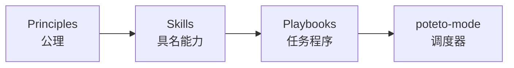

# 15 · poteto-mode 与运行时

前面的原则、能力、程序三层是静态的。poteto-mode 是调度器,它把这些组合成一个**运行时**。

这一篇回答一个具体的问题:你敲了一句话,没有指定任何 skill,然后 todo list 自动长出了十几条步骤,最后交回一段带证据的回复。中间到底发生了什么。

## poteto-mode 是什么

它不是一个能力,它坐在 playbook 之上,是一个调度器。

它被调用时做三件事。

它把任务匹配到一个 playbook,打开一个 todo list,而 todo list 的**前几条就是那个 playbook 的步骤,原样拷贝进来**。你要做的改动匹配 feature,前几条 todo 就是 feature 的那串步骤;匹配 bug-fix,就是 bug-fix 的那串。

它随着步骤触发,路由到其他 skill。feature 的其中一个步骤是"先摸清受影响的子系统",它就在那一刻去调 `how`;其中一步是"并行设计探索",它就去调 `architect`。

它写出 unslopped 的回复,而且这个回复是**给两个人**写的:消费者(这次工作的用户)和维护者(下一个接手代码的工程师)。它要求先说清楚对这两类人各自意味着什么,再谈实现细节。

## 第二套规则:常驻触发

playbook 匹配是它的一条路由线。它还有第二条,一组常驻触发,写在 skill 的 Non-negotiables 一节里。这些和"你这次要做什么任务"无关,它们是任何任务里都会触发的转交。

几个例子。任何一个代码改动,先命名数据形状。代码要跨函数边界,先跑 `architect`。设计有争议,先跑 `interrogate`。要并行 fan-out,用 `swarm` 或 `arena`。任何面向人的散文,过一遍 `unslop`。运行一次 benchmark 或者要报告一个你测出来的数字,先过 `benchmark-checklist`。

这一套的解释器决定了 pstack 不只是"23 个可选流程",它是一组会主动接管的行为。你不需要记得这些触发,调度器替你记得。

## todo 契约

调度器的第一件事里有一条很聪明的设计:步骤原样拷贝,而且**跳过不删**。

一个它决定不做的步骤,不会从 todo list 里消失,而是留在原地,标一条 `skip: <原因>`。

这一条把"它打算怎么做"变成了可见、可反对的东西。你一眼就能看到它选择不做什么,以及它给的什么理由。如果它跳过了你其实很在意的一步,你当场就能拦下来。

## 原则索引和点名规则

调度器还在自己的文件里内联了一份**原则索引**,24 个名字,每个一句话,外加"何时适用"。它在任务开始读这份索引,应用任务触发的那些原则。

然后它有一条堵死"报菜名"的规则:回复里**点名**每一条改变了某个决定的原则,而且只能点名本次真正读过 leaf `SKILL.md` 的那些。

这一条值得单独说。它针对的失败模式是:agent 在回复里挂一串漂亮的原则名字,但没有一个真的影响了它的行为。要求它点名"这条原则改变了哪个决定",而且只许点它真读过的,就把引用从一个修辞动作变成了一个证据动作。

## 模型角色

调度器在派 subagent 时,默认给每个角色指定一个模型,按角色的性质分。

写代码的委派用快的模型。写散文和做判断的用最强的模型。最难的那类改动(跨切面的设计、难缠的并发、微妙的算法),用你最强的判断模型,不管它需要的是对模糊意图的判断,还是一串要严格照做的精细步骤。纯粹机械的小编辑给快模型。

subagent 默认是**全新的**。新的工作给一个新的 subagent,带一份合并过的范围(原始简报、后来所有指令、上一个 agent 的报告和分支)。只有新工作确实需要那个 agent 里、又很难搬走的状态(它的本地 checkout、它还没提交的改动、它还在跑的一个进程)时,才复用。这条规则拦住的是"接力式的续跑悄悄丢掉指令"。

## 自主规则

调度器带一份自主契约,分三条。

**Just do it。** 可逆的工作和外部动作(团队聊天、更新 ticket、踢一次 eval)不用问。

**Always pause。** 不可逆的写(往共享分支 force-push、部署、删数据、给客户发消息)必须确认。

**Session overrides。** "别停""我要去睡了""跑到做完""完全自主",都会让它不再问,继续跑。

这三条和原则篇里的 never-block-on-the-human 是同一件事的落地:分界线是可逆性,不是重要性。

## 在运行时里,构造是自下而上,执行是自上而下

这是理解整个 pstack 的一把钥匙,值得画出来。

**构造是自下而上的。**

原则在底层被写清楚一次。skill 按名字引用原则。playbook 编排 skill。调度器匹配 playbook。

**执行是自上而下的。**

一个目标进来,匹配到一个程序,程序里的每一步触发能力,能力按名字引用底层的公理,最后收在一个验证闸门和一个证据上。

把这两张图合起来看,你就得到了那一句让一句话能带这么多 rigor 的解释:**顶层只有一张路由表,它选出的那个程序只按名字引用底层公理,而那些公理只在底层写过一次。**

## poteto-agent、Comment Sicko 和 benny

调度器不是只有你在聊天窗口里用的那一个版本。同一套东西会往下传播。

`poteto-agent` 是一个把整套 poteto 风格端到端跑完的 subagent。它在做任何工作之前,会把 poteto-mode 读全,包括那份内联的原则索引。所以当一个 playbook 步骤要派一个 subagent 时,它派的是 `poteto-agent`,风格就随之下沉到整棵树。README 里有一条警告:换成通用的 subagent,会跳过那次读取,然后开始漂移。

`Comment Sicko` 是一个只读的注释 reviewer,通过 `no-comments` 调用,一般不直接叫它。

`benny` 是一个休眠的自动化包,处理 Slack 上的问题报告。它先分诊,确认后再复现并修,带真实的 UI 证据。它体现两条规则:每一阶段都能叫停整条线,每一阶段都要交接证据。所以一个人在读任何一行代码之前,就能先检查 agent 修的是不是对的东西。

## 边界

调度器是一个**默认入口**,不是强制。任何 skill 你都可以直接调。它的存在,是在你没有明确偏好时替你选和排。当你想覆盖某个具体选择时,点一个 skill 的名字就行。

## 今天就做一件事

下一次你敲 `poteto-mode`,先别急着看它做了什么,先看 todo list 的**前几条**。那几条就是它替你选的那个程序。读它们,你就知道这次它会走一条什么样的路。
