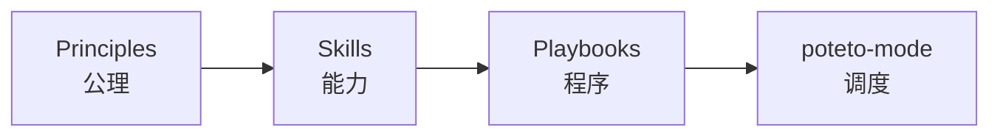
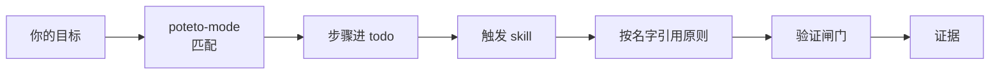

# 15 · poteto-mode 与运行时

前面三层是静态的。poteto-mode 是调度器,它把原则、skill、playbook 组合成一个**运行时**。

这一篇回答一个具体的问题:你敲了一句话,没有指定任何 skill,todo list 自动长出了十几条步骤,最后交回一段带证据的回复。中间发生了什么。

## poteto-mode 是什么

它不是一个能力,它坐在 playbook 之上,是一个调度器。它的文件里放着六样东西:一张**常驻触发表**(Non-negotiables)、一份**原则索引**、一份**自主契约**、一份**子 agent 规矩**、一份**回复规矩**,以及 **23 个 playbook** 的目录。

它被调用时做三件事。

它把任务匹配到一个 playbook,打开一个 todo list,而 todo list 的**前几条就是那个 playbook 的步骤,原样拷贝进来**。你要做的改动匹配 feature,前几条 todo 就是 feature 的那串步骤。

它随着步骤触发,路由到其他 skill。feature 的一步是"先摸清受影响的子系统",它就在那一刻去调 `how`;一步是"并行设计探索",它就去调 `architect`。

它写出一段 unslopped 的回复,而且这段回复是**给两个人**写的:这次工作的用户,和下一个接手代码的维护者。

## 第一套路由:任务到 playbook

匹配上一个 playbook 时,它把那个 playbook 的步骤**原样拷贝**进 todo list。这里有一条很聪明的设计:**跳过不删**。一个它决定不做的步骤,不消失,留在原地,标一条 `skip: <原因>`。这把"它打算怎么做"变成了可见、可反对的东西:你一眼看到它选择不做什么,以及理由。

它还有一条关于层级的判断。大的、跨切面的努力(跨很多调用点的迁移、一个野心勃勃的多部分改动),即使某个更窄的 playbook(比如 feature)看起来合适,也路由到 `figure-it-out`,由它为这个任务**设计一个定制的、可审计的工作流**。而一个程序规模的项目(多天、很多 PR、一支 subagent 舰队)路由到 `orchestrate`。

## 第二套路由:常驻触发

playbook 匹配是它的一条路由线。它还有第二条,一组写死在文件里的常驻触发,和"你这次要做什么"无关。这些是任何任务里都会发生的转交。挑几条感受一下它的密度:

- 任何代码 → 先命名数据形状。
- 代码跨函数边界 → `architect`。
- 任何并行 fan-out → `swarm` 或 `arena`。
- 有争议的设计 → `interrogate`。
- 任何面向人的散文 → `unslop`;文档、RFC、readme、PR 描述、commit message → `technical-writing`。
- 跑 benchmark 或报告一个你测出的数字 → `benchmark-checklist`。
- 任何 PR 状态请求 → babysit playbook,而不是 Cursor 内建的那个同名 skill。
- 要落地一个绿的栈 → shipping playbook,因为 green is not safe。
- 大、长、无人值守的工作 → `show-me-your-work`。

这一套让你不必记得这些触发:调度器替你记得。

## 原则索引和点名规则

调度器在自己的文件里内联了一份**原则索引**,24 个名字,每个一句话,外加"何时适用"。它在任务开始读这份索引,应用任务触发的那些原则。

然后它有一条堵死"报菜名"的规则:回复里**点名**每一条改变了某个决定的原则,而且**只能点名本次真正读过 leaf `SKILL.md` 的那些**。它针对的失败是:agent 挂一串漂亮的原则名字,却没有一个真的影响了行为。要求它点名"这条原则改变了哪个决定",而且只许点它真读过的,就把引用从一个修辞动作变成证据动作。

## 自主契约

三条。

**Just do it。** 可逆的工作和外部动作(团队聊天、更新 ticket、踢一次 eval)不用问。

**Always pause。** 不可逆的写(往共享分支 force-push、部署、删数据、给客户发消息)必须确认。

**Session overrides。** "别停""我要去睡了""跑到做完""完全自主",都会让它不再问,继续跑。

还有一条值得单独说:**"不"是一个可接受的回答。** 被问要不要做某事、被邀请扩大范围、或看到一种做法时,它给真实判断。不、反驳、或者说"这个不值它的位置",在真的成立时都成立。它不会把"同意"当成默认。

## 子 agent 的规矩

它在派 subagent 时,默认给每个角色指定一个模型,按角色的性质分:写代码用快的模型,写散文和做判断用最强的模型,最难的那类改动(跨切面设计、难缠的并发、微妙算法)用最强的判断模型,纯机械的小编辑给快模型。每个 subagent 默认后台运行、用 agent 模式(只读模式会剥掉 MCP)、拿文件指针而不是内联上下文。

它还带一条关于**你**的规矩:你拥有每一个 subagent 的工作。审查它的 diff,写你自己的总结,不要把它说的话转手递出去。一个第二意见,是同一个 prompt 对另一个模型,两份一致是高信号。

subagent 默认是**全新的**。新工作给一个新 subagent,带一份合并过的范围。只有新工作确实需要那个 agent 里、又很难搬走的状态(它的本地 checkout、未提交的改动、它还在跑的一个进程)时,才复用。这条规矩拦的是"接力式续跑悄悄丢掉指令"。

## 写回复的规矩

回复本身也是产物,而且是**给人看的那一个产物**。所以有规矩:短句,一句一个意思,句号结尾。不用破折号。冒号不能当句中的连接词。但**简短不是丢掉内容的借口**:playbook 要求的每个部分(细节、权衡、选择、开着的决定)都要在。内容要先为消费者和维护者框定影响,再谈实现细节。

还有两条在防"看起来可信":**绝不编造链接或引用**(只链本次真的产出或读过的);每一条声明都要在**同一句**里带上它的证据或它的标签(测得的、推断的、还是猜的)。这两条的目标是让读者不用相信你、也不用自己重跑一遍,就能判断每句话的分量。

## 注释

注释和回复同规矩:写得干净,而不是先写脏再清。它的理由是注释会腐烂,而且大多在重复代码已经说清的事;一条注释只有在解释代码说不出来的 why 时才值得留。验证脚本和测试脚本**没有**叙述阶段的注释,比如 `// Phase 1: add cards`;断言或日志字符串本身就记录了那一步。这条规矩覆盖它产出的每一个文件,包括它委派出去的 agent 的 diff。而"作者会替自己辩护"这件事,让注释的清理归到另一趟里做(`no-comments`),不归写它的人。

## 跨 harness

它是在 Cursor 上写的,但一份配置解决不了移植。所以它用一节 Harness 把 Cursor 的每个具体件映射到别的 harness:subagent 工具的名字、`poteto-agent` 不在时怎么用一个通用 subagent 替代、模型设置文件写在哪、transcript 目录在哪、skill 文件夹在哪、结构化提问工具叫什么。它还点明 pstack 没有带但会引用到的东西(`create-skill`、`deslop`、`control-cli/control-ui`、`/loop`),以及在没有它们时怎么用别的办法顶上。这一节是 pstack 能真的跑在 Cursor 之外的原因。

## 构造自下而上,执行自上而下

这是理解整个 pstack 的一把钥匙。

原则在底层被写清楚一次。skill 按名字引用原则。playbook 编排 skill。调度器匹配 playbook。这是**构造**,自下而上。

一个目标进来,匹配到一个程序,程序里的每一步触发能力,能力按名字引用底层的公理,最后收在一个验证闸门和一个证据上。这是**执行**,自上而下。

把两张图合起来,就得到了那一句让一句话能带这么多 rigor 的解释:**顶层只有一张路由表,它选出的那个程序只按名字引用底层公理,而那些公理只在底层写过一次。**

## poteto-agent、Comment Sicko 和 benny

调度器不是只有你在聊天窗口里用的那一个版本。同一套东西会往下传播。

`poteto-agent` 是一个把整套 poteto 风格端到端跑完的 subagent。它在做任何工作之前,会把 poteto-mode 读全,包括那份内联的原则索引。所以当一个 playbook 步骤要派一个 subagent 时,它派的是 `poteto-agent`,风格就随之下沉到整棵树。README 有一条警告:换成通用的 subagent,会跳过那次读取,然后开始漂移。

`Comment Sicko` 是一个只读的注释 reviewer,通过 `no-comments` 调用。

`benny` 是一个休眠的自动化包,处理 Slack 上的问题报告:先分诊,确认后再复现并修,带真实 UI 证据。它体现两条规则:每一阶段都能叫停整条线,每一阶段都要交接证据。所以人在读任何一行代码之前,就能先检查 agent 修的是不是对的东西。

## 边界

调度器是一个**默认入口**,不是强制。任何 skill 你都可以直接调;它的存在,是在你没有明确偏好时替你选和排。当你想覆盖某个具体选择时,点一个 skill 的名字就行。这也解释了它为什么要求你说目标、别枚举 skill:它已经带着一张比你临时手写更全的地图,而手写的序列通常会重排或漏掉那张地图里的步骤。

## 今天就做一件事

下一次你敲 `poteto-mode`,先别急着看它做了什么,先看 todo list 的**前几条**。那几条就是它替你选的那个程序。读它们,你就知道这次它会走一条什么样的路。

## 读原文

这一篇拆的是 pstack 仓库里的这几份文件,想读一手材料从这里进:

- [`poteto-mode`](https://github.com/backnotprop/pstack/blob/main/skills/poteto-mode/SKILL.md)
- [`poteto-agent`](https://github.com/backnotprop/pstack/blob/main/agents/poteto-agent.md)
- [`comment-sicko`](https://github.com/backnotprop/pstack/blob/main/agents/comment-sicko.md)
